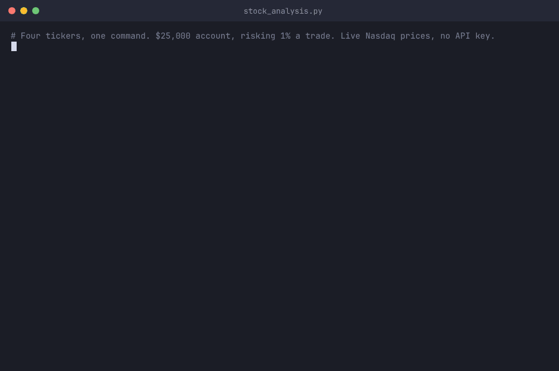
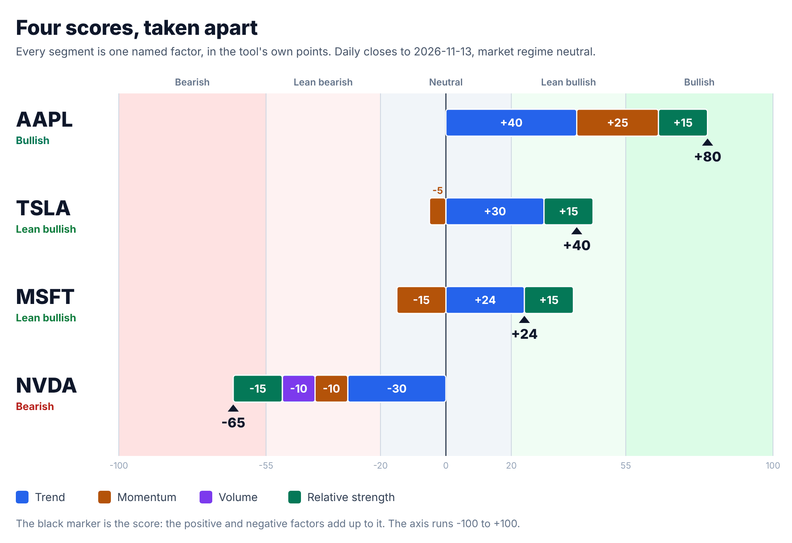
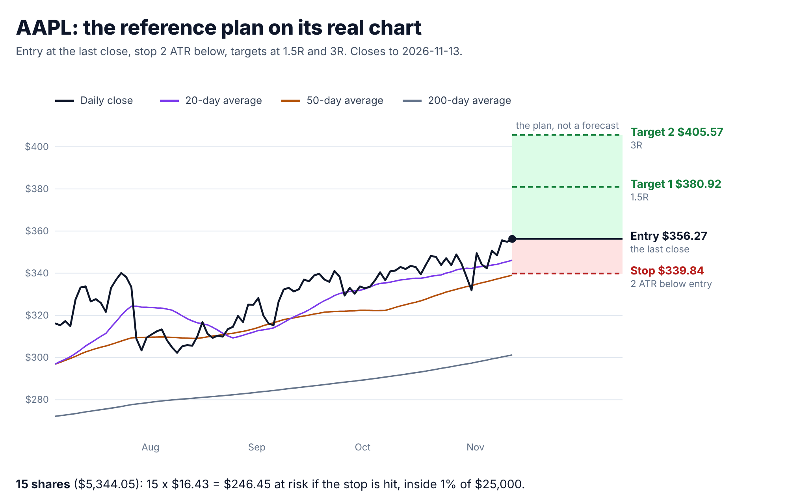
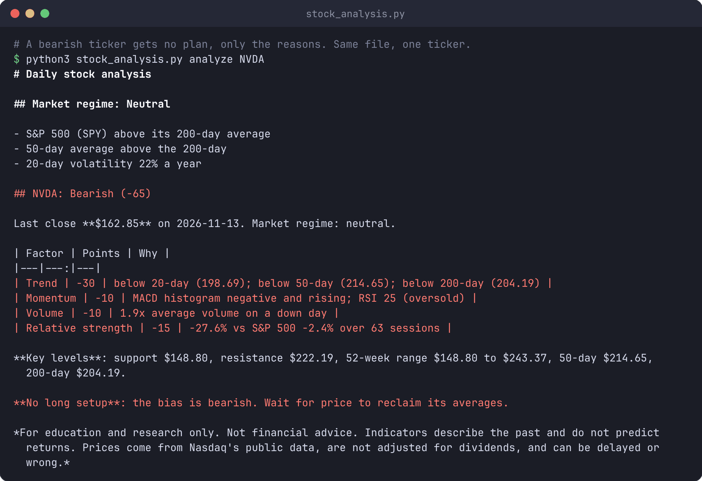
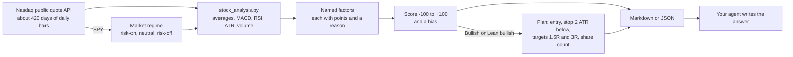

<p align="center"></p>
<h1 align="center">Daily Stock Analysis</h1>
<p align="center"><b>Know where a US stock stands in ten seconds, and exactly why.</b></p>
<p align="center">
  <a href="https://github.com/FinnTech3/Daily_StocK_Analysis/actions/workflows/ci.yml"></a>
  
  
  
  
</p>
<p align="center"></p>

<sub>Real run on 15 Nov 2026, closes of 13 Nov. The clip cuts the long tail of each output and says so on screen (`... N more lines`). Nothing is edited.</sub>

## The straight answer

- **What it does.** Turns daily prices into a score from -100 to +100 and shows its working: every point is a named factor (trend, momentum, volume, strength against the S&P 500) with a plain-English reason. A bullish or lean bullish setup also gets an entry, a stop, two targets and a share count for your account and risk.
- **What it needs.** Python 3.10 or newer and a connection to `api.nasdaq.com`. No API key, no packages, no account. It reads no local files and writes none.
- **What it won't do.** Predict anything, place trades, or look past price. Daily technical analysis of US stocks and ETFs only. No news, earnings, fundamentals, options, crypto or short-side plans. Not financial advice.

## See it work

<p align="center"></p>

**Why the scores differ.** One row per stock, one segment per named factor, in the tool's own points. NVDA is -65 because trend, momentum, volume and relative strength all point down. MSFT is +24, not +39, because momentum takes 15 points back.

<p align="center"></p>

**The plan, on the chart.** AAPL's reference plan drawn over its real closes. The stop sits 2 ATR below the entry, so 15 shares risk $246.45, inside 1% of $25,000. It is a plan, not a forecast.

<p align="center"></p>

**It says no.** NVDA gets the reasons and no plan. Only Bullish and Lean bullish setups get one.

All three come from one run (4 tickers, `--account 25000`, closes of 13 Nov 2026). The JSON is in [sample-output.json](agensi/daily-us-stock-analysis/examples/sample-output.json) and the written answer an agent gives from it is in [sample-answer.md](agensi/daily-us-stock-analysis/examples/sample-answer.md).

## Run it in 60 seconds

Needs Python 3.10 or newer. The whole tool is one file, so you can also copy `stock_analysis.py` anywhere and run it.

```bash
git clone https://github.com/FinnTech3/Daily_StocK_Analysis
cd Daily_StocK_Analysis/agensi/daily-us-stock-analysis/scripts
python3 stock_analysis.py analyze AAPL MSFT NVDA TSLA --account 25000
```

That took about 6 seconds here, almost all of it network. A few more:

```bash
python3 stock_analysis.py market            # risk-on, neutral or risk-off
python3 stock_analysis.py analyze BRK.B     # class shares use a dot
python3 stock_analysis.py analyze NVDA --json
```

Want a short command? From the repo root, `pip install .` gives you `dsa analyze AAPL`.

| Option | Meaning |
|---|---|
| `--account` | Account size in USD. Adds share counts to the plan. |
| `--risk` | Percent of the account risked per trade (default 1, maximum 10). |
| `--json` | JSON instead of Markdown. This is what the agent skill reads. |

Tickers can be separated by spaces or commas. Exit codes: `0` all tickers analysed, `1` some failed (for `market`: the S&P 500 read failed), `2` none succeeded or bad input.

## Use it with your agent

[`agensi/daily-us-stock-analysis`](agensi/daily-us-stock-analysis) is the skill: `SKILL.md`, the script, a scoring reference and examples. Install it from the Agensi listing, or drop that folder into your agent's skills folder.

1. Ask it things like "How does AAPL look?", "Rank my watchlist: MSFT, NVDA, TSLA" or "I have $25,000 and risk 1% a trade. Size a position in AAPL."
2. The agent writes the script unchanged to a temporary file, runs it with `--json`, and deletes it.
3. It answers in a fixed order: market line, ranked table, the biggest factors per ticker, the plan or the reason for none, warnings, disclaimer.
4. Every number in the answer comes from the JSON. The agent never does the maths or fills a gap from memory.

| Cost | What it means |
|---|---|
| Time | About 6 seconds a run |
| Permissions | Run one Python script from a temporary file |
| Network | HTTPS to `api.nasdaq.com` only |
| Files | None read, none written |
| Money | Nothing here. The code is MIT. The Agensi upload is built from the skill folder in this repo. |

## How it works



<details>
<summary>The score, factor by factor</summary>

The score is the sum of the factors below, limited to -100 to +100. The exact rules are in [scoring.md](agensi/daily-us-stock-analysis/references/scoring.md).

| Factor | Range | What it measures |
|---|---:|---|
| Trend | +/-40 | Price against the 20, 50 and 200-day averages, and how those averages stack |
| Momentum | +/-25 | MACD histogram and its direction, plus the RSI zone |
| Volume | +/-10 | Whether a move is backed by above-average volume |
| Relative strength | +/-15 | Three-month return against the S&P 500 |
| Extension | -8 | Price stretched more than 3 ATR above its 20-day average |
| Market regime | +5 / -15 | Risk-on or risk-off backdrop |

| Score | Bias |
|---:|---|
| 55 and up | Bullish |
| 20 to 54 | Lean bullish |
| -19 to 19 | Neutral |
| -54 to -20 | Lean bearish |
| -55 and below | Bearish |

**Trade plan.** Only for Bullish and Lean bullish. Entry is the last close, or the 20-day average when price is extended (then the plan waits for a pullback, so its targets can sit below the current price). The stop is 2 ATR below entry. Targets sit at 1.5R and 3R. Shares are the risk you allow, divided by the risk per share, capped by your account size.

</details>

## Why it's built this way

- **Every point has a name.** I'd rather you could argue with a score than trust it. Each one is a named factor with a reason, so a wrong call is easy to spot.
- **The market comes first.** It reads the S&P 500 trend and volatility, and marks stocks down 15 points in a risk-off market.
- **The agent never does the maths.** The script computes, the agent explains. The same ticker gives the same numbers every time.
- **One file, standard library only.** Agensi delivers skills as text, so the script has to run on its own. 20 KB, nothing to install, one file to audit.
- **It prefers "no" to a guess.** Neutral and bearish tickers get no plan. Stale data, short history, a possible split or a bad ticker raise a warning or an error, never a silent fix.

## What it won't do

- Intraday. Daily bars only.
- Anything beyond price and volume: no earnings dates, news, valuation or fundamentals.
- Non-US stocks, options, crypto or indexes such as the VIX (use an ETF such as SPY or QQQ).
- Short-side plans. Long side only.
- Promise its data source stays put. Prices come from Nasdaq's public quote endpoint, which can change, rate-limit or return gaps. When it fails the skill says so and never falls back to remembered prices. Prices are not adjusted for dividends and can be delayed or wrong. Check anything you act on.
- Predict. Past price behaviour does not predict future returns.

## Develop / verify

```bash
pip install -e ".[dev]"
pytest -q                                                      # 216 offline tests
ruff check .
python3 tools/agensi_build.py agensi/daily-us-stock-analysis   # Agensi checker, builds dist/
```

The media is real. `docs/media-src/regen.sh` reruns the commands against live prices and redraws every image, clip and listing screenshot (needs Pillow, pytest, Node with Playwright and ffmpeg). The numbers move with the market, so refresh the examples after a rebuild. `chart-data.json` there is the snapshot the charts were drawn from.

## Finn's take

Most stock tools hand you a number and ask you to trust it. I wanted one you can take apart. This is a deliberately boring, rules-based, daily-bar tool: it will not find the next big winner, and it knows nothing about earnings or news. What it does is show its working, size a position from the stop rather than from a feeling, and say "no plan" when the trend is against you. Use it as a second opinion, then look at the chart yourself.

Built by FinnTech3.

## Disclaimer

For education and research only. This is not financial advice or an offer to buy or sell anything. Trading involves substantial risk of loss.

## Licence

MIT, see [LICENSE](LICENSE).
